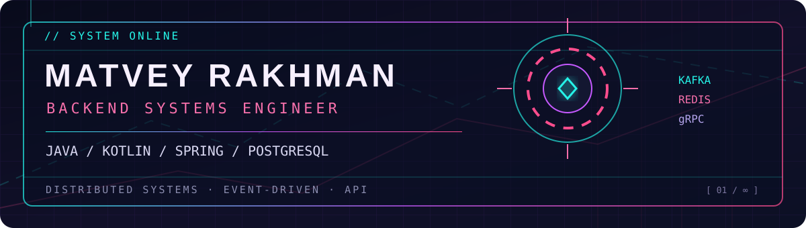

  

<h1 align="center">Привет, я Матвей Рахман</h1>

Backend-разработчик · Java / Kotlin · студент ИТМО

  Проектирую API и сервисы, работаю с транзакциями, событиями и данными. 
  Люблю, когда система остаётся понятной под нагрузкой и удобной для команды.

### Основной стек

**Языки:** Java · Kotlin · SQL · TypeScript · Python  
**Backend:** Spring Boot · Spring Data JPA · Spring Security · Spring Cloud · Hibernate · Ktor  
**Данные:** PostgreSQL · MySQL · Redis · MongoDB · Flyway · Liquibase  
**Интеграции:** REST · gRPC · Kafka · RabbitMQ

Ещё технологии и подходы

NestJS, Node.js, ClickHouse, Docker, Kubernetes, Maven, Gradle, GitLab CI, Prometheus, JUnit, Mockito, Testcontainers, React. Работаю с микросервисами, Event-Driven, Outbox, Saga, CQRS и DDD.

### Связаться

[Написать на почту](mailto:rakhmannis@gmail.com)
